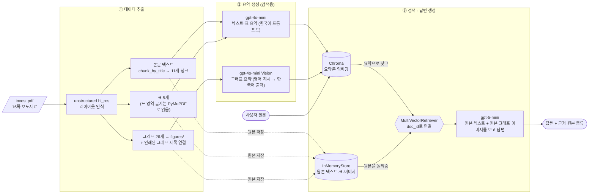
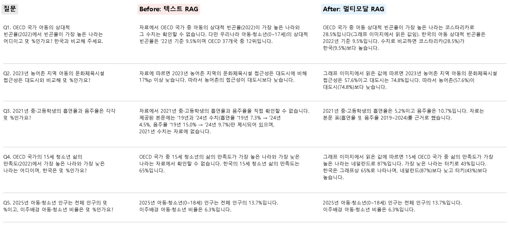

# 멀티모달 RAG — 「아동·청소년 삶의 질 2025」 보도자료

PDF 속 **텍스트·표·그래프 이미지**를 함께 검색해서 답하는 멀티모달 RAG입니다.
실행 결과가 남아 있는 노트북: [`notebooks/Multi_modal_RAG.ipynb`](notebooks/Multi_modal_RAG.ipynb)

## 1. 문제 정의

**자료**: 국가데이터처 국가통계연구원 보도자료 「아동·청소년 삶의 질 2025」 보고서 발간 (2025.10.1, 16쪽, 공개 자료) — `data/invest.pdf`

- 그래프 26개와 표 5개가 들어 있는 통계 자료입니다. 8개 영역(물질적 상황, 건강, 학습, 안전 등)으로 나뉘어 있습니다.
- 본문에는 **요약된 문장 몇 개**만 있고, 실제 수치 대부분은 **그래프 안에만** 있습니다.
  - 예) 본문: "농어촌은 문화체육시설 접근성이 17%p 이상 낮음" → 정확한 값(대도시 74.8%, 농어촌 57.6%)은 막대그래프에만 있음
  - 예) 본문: "한국은 OECD 37개국 중 12위, 핀란드가 가장 낮음" → 가장 높은 나라(코스타리카 28.5%)는 그래프에만 있음
  - 예) 본문: 흡연율은 '19년과 '24년 값만 있음 → 2020~2023년 값은 표에만 있음
- 그래서 텍스트만 검색하는 RAG로는 "몇 %인가요?", "가장 높은 나라는?" 같은 **통계 자료에서 가장 흔한 질문**에 답하지 못합니다.
  표와 그래프까지 검색하고 읽을 수 있어야 이 자료를 제대로 활용할 수 있습니다.

## 2. 아키텍처



### 왜 '요약으로 검색'하고 '원본으로 생성'하는가

검색은 원본으로 찾기 어렵기 때문에 요약으로 찾아야 함. 찾기 어려운 이유는 자료의 유형들이 다 다르기 때문이다. 질문은 글이고, 그래프는 그림이기 때문이다. 답을 원본으로 만드는 이유는 요약한 내용은 틀리거나 빠진 내용이 있을 수 있기 때문이다.

## 3. 기술 선택 근거

| 항목 | 선택 | 근거 |
| --- | --- | --- |
| 추출 | `unstructured` `hi_res` | `fast` 전략은 그림을 추출하지 못함. 레이아웃 모델이 그래프 영역을 찾아 `figures/`에 잘라 줌 |
| 표 내용 | PyMuPDF로 PDF 텍스트 레이어에서 읽기 | Tesseract에 한국어 데이터가 없어서 표 OCR 결과가 깨짐(`Apsja) oy W6`). 이 PDF에는 텍스트 레이어가 있으므로 **표 영역 좌표만 unstructured에서 받고** 글자는 원문 그대로 읽음 |
| 그래프 선별 | 275개 중 26개 사용 | 1쪽 로고, 20KB 미만 조각, 가로로 긴 띠 모양 조각을 제외 (`select_figures`) |
| 그래프 제목 | 그림 바로 위의 `< 제목 >`을 찾아 요약 프롬프트에 넣음 | 잘린 그래프 이미지에는 제목이 없어서, 처음에는 요약이 "연도별 지표 변화"처럼 뭉뚱그려 나와 검색이 되지 않았음 |
| 청크 | `chunk_by_title`(최대 4,000자) → 2,000토큰 / 겹침 200 | 보도자료가 "□ 지표 → ㅇ 세부 설명" 단위로 쓰여 있어 제목 단위로 자르면 한 지표의 설명이 한 덩어리에 들어감. 겹침 200은 경계에서 문장이 잘리는 것을 막기 위함 |
| 요약 모델 | `gpt-4o-mini` | 요약은 호출 수가 많으므로(42회) 저렴한 모델. 비전 기능도 있어 텍스트·이미지를 한 모델로 처리 |
| 답변 모델 | `gpt-5-mini` | 사전 테스트에서 `gpt-4o-mini`는 OECD 그래프의 최댓값 국가를 '멕시코'로 잘못 읽었고, 텍스트 RAG에서는 '미국 20.7%'라는 없는 값을 지어냄. `gpt-5-mini`는 같은 질문에서 코스타리카 28.5%로 정확했음. 답변은 질문당 1회라 비용 부담이 작음 |
| 프롬프트 언어 | 텍스트·표 요약: 한국어 / 이미지 요약: 영어 지시 + 한국어 출력 / 답변: 한국어 | 질문과 문서가 한국어이므로 **요약문은 반드시 한국어**여야 임베딩 검색이 잘 맞음. 이미지 지시문은 모델이 가장 안정적으로 따르는 영어로 쓰고 마지막에 출력 언어만 한국어로 지정 |
| 임베딩 / 벡터DB | `text-embedding-3-small` / Chroma | 한국어 지원, 저렴. 이 자료는 문서 42개라 로컬 Chroma로 충분 |
| 검색 개수 | k = 5 | 한 질문에 그래프와 본문 설명이 함께 걸리도록 넉넉하게 설정 |

**비용 측정** (노트북 출력 기준): 텍스트·표 요약 입력 약 8,666토큰, 요약 출력 약 7,863토큰, 그래프 26장. 요약 소요 시간은 텍스트·표 약 13초, 그래프 약 99초(실습과 같이 한 장씩 차례로 요약).

## 4. Before / After 비교 — 텍스트 RAG vs 멀티모달 RAG

비교 조건은 같은 답변 모델(`gpt-5-mini`), 같은 프롬프트, 같은 k=5입니다. Before는 **본문 텍스트 청크만** 임베딩했습니다.



| | 텍스트 RAG (Before) | 멀티모달 RAG (After) |
| --- | --- | --- |
| 정답 | **1 / 5** (Q5만 완전 정답, Q2는 "17%p 낮다"는 차이까지만) | **5 / 5** |
| 실패 양상 | 그래프·표에만 있는 값은 "자료에서 확인할 수 없습니다" | 그래프 이미지에서 직접 읽은 값이라고 밝히며 답변 |

**차이가 생긴 이유**
- Q1, Q4 (OECD 국가 비교): 국가별 값은 막대그래프에만 있습니다. 텍스트 RAG는 본문의 "한국 9.5%, 핀란드 가장 낮음"까지만 답합니다.
  멀티모달 RAG는 그래프 요약("OECD 국가 아동의 상대적 빈곤율… 코스타리카 28.5%")으로 그래프를 찾고, 원본 이미지에서 값을 읽었습니다.
- Q2 (지역별 접근성): 본문에는 "17%p 이상 낮다"는 차이만 있습니다. 멀티모달 RAG는 그래프에서 74.8%와 57.6%를 읽어 정확한 값으로 답했습니다.
- Q3 (2021년 흡연율): 2021년 값은 표에만 있습니다. 표 요약이 "흡연율 및 음주율 2019~2024"로 검색되어 원본 표에서 5.2%와 10.7%를 찾았습니다.
- Q5 (인구 비율): 본문에 문장으로 적힌 값이라 두 방식 모두 정답입니다. **멀티모달 RAG가 텍스트 질문에서 손해를 보지 않는다는 것**도 확인했습니다.

## 5. 질의응답 5건

| # | 질문 | 답변 (멀티모달 RAG) | 근거가 된 원본 종류 |
| --- | --- | --- | --- |
| 1 | OECD 국가 아동의 상대적 빈곤율(2022)에서 가장 높은 나라와 수치는? 한국과 비교 | 코스타리카 28.5%(그래프에서 읽음). 한국은 9.5%로 코스타리카보다 낮음 | **이미지** `figure-5-242.jpg` (OECD 국가 아동의 상대적 빈곤율) + 텍스트 |
| 2 | 2023년 농어촌 아동의 문화체육시설 접근성은 대도시와 비교해 몇 %? | 농어촌 57.6%, 대도시 74.8% → 농어촌이 대도시의 약 77% 수준으로 낮음 | **이미지** `figure-6-245.jpg` (지역규모별 거주지역 편의성) + 텍스트 |
| 3 | 2021년 중·고등학생의 흡연율과 음주율은? | 흡연율 5.2%, 음주율 10.7% | **표** `table-3` (13쪽 흡연율 및 음주율 2019~2024) |
| 4 | OECD 15세 삶의 만족도(2022) 최고·최저 국가와 한국은? | 최고 네덜란드 87%, 최저 튀르키예(답변에서는 '터키') 43%, 한국 65% | **이미지** `figure-16-275.jpg` (OECD 국가의 삶의 만족도) + 텍스트 |
| 5 | 2025년 아동·청소년 인구 비율과 이주배경 아동·청소년 비율은? | 전체 인구의 13.7%, 이주배경 비율 6.3% | **텍스트** `text-1` (본문 1. 사회적 배경) |

전체 답변과 검색된 원본 목록은 [`docs/qa_results.json`](docs/qa_results.json)에 있습니다. 정답 여부는 PDF 원본 그래프와 표를 직접 보고 확인했습니다.

## 6. 실행 방법

```bash
python -m venv .venv
.venv\Scripts\activate
pip install -r requirements.txt        # 버전 그대로 재현: requirements.lock.txt
```

`hi_res` 전략에는 Poppler와 Tesseract가 필요합니다. pip 패키지가 아니므로 따로 설치한 뒤 PATH에 등록하세요.

```bash
winget install UB-Mannheim.TesseractOCR
winget install oschwartz10612.Poppler
```

`.env.example`을 `.env`로 복사한 뒤 `OPENAI_API_KEY`를 채우고, `notebooks/Multi_modal_RAG.ipynb`를 위에서부터 차례로 실행합니다.
추출에 약 1.5분, 요약에 약 2분, 질의 10회(5건 × 2개 체인)에 약 45초가 걸립니다.

```
├── data/invest.pdf               # 원본 PDF
├── figures/                      # 추출된 이미지 (figure-<쪽>-<번호>.jpg)
├── docs/                         # Before/After 캡처, 질의응답 결과
├── notebooks/Multi_modal_RAG.ipynb
└── src/                          # RAG 3단계를 파일 3개로 분리 (파일 하나 = 단계 하나)
    ├── extract.py                # ① 추출: extract_pdf_elements, categorize_elements, split_texts,
    │                             #          select_figures, find_captions
    ├── summarize.py              # ② 요약: generate_text_summaries, encode_image,
    │                             #          image_summarize, generate_img_summaries
    └── retriever.py              # ③ 검색·답변: create_multi_vector_retriever, split_image_text_types,
                                  #          img_prompt_func, multi_modal_rag_chain, create_text_retriever(비교용)
```

노트북은 이 세 파일을 `import`해서 ① → ② → ③ 순서로 실행하고 결과를 보여 주기만 합니다.
함수 이름과 구조는 수업 실습(01_데이터추출, 02_요약생성)과 같게 맞췄습니다.

## 7. 한계

- **한국어 OCR 미사용**: Tesseract 한국어 데이터가 없어 텍스트 레이어로 우회했습니다. 스캔본 PDF처럼 텍스트 레이어가 없는 자료에는 이 방식을 쓸 수 없습니다.
- **잘게 쪼개진 그래프**: 14쪽 "부모와 함께 보내는 시간" 그래프는 레이아웃 모델이 띠 모양 조각 여러 개로 잘라서 검색 대상에서 빠졌습니다. 이 그래프에만 있는 값은 답할 수 없습니다.
- **본문 속 잡음**: 그래프 안의 글자를 영어 OCR로 읽은 깨진 문자열이 일부 텍스트 청크에 남아 있습니다(예: `= 77a 0~18A]`).
- **요약 오류**: `gpt-4o-mini` 이미지 요약에서 막대 순서를 잘못 읽은 경우가 있었습니다. 답변 단계에서 원본 이미지를 다시 보는 구조라 최종 답에는 영향이 없었지만, 요약이 틀리면 검색 자체가 빗나갈 수 있습니다.
- **답변의 비결정성**: `gpt-5-mini`는 temperature를 고정할 수 없어서 실행할 때마다 문장이 조금씩 달라집니다. 실제로 한 번은 "9.5%가 28.5%보다 높다"처럼 비교 방향을 틀리게 쓴 적이 있어, 프롬프트에 "숫자로 다시 확인한 뒤 높다/낮다를 쓰라"는 지시를 추가했습니다.
- **평가 규모**: 질문 5건으로 직접 채점했습니다. 더 많은 질문으로 자동 평가하지는 않았습니다.

## 8. 보안

- API 키는 `.env`에만 두고 `.gitignore`로 제외했습니다. 저장소에는 키 이름만 적힌 `.env.example`만 올렸습니다.
- 노트북은 키 값을 출력하지 않고 로드 여부(`OK`)만 출력합니다.
- `.venv/`, `__pycache__/`, 중간 산출물(`data/processed/`, `*.pkl`), IDE 설정 등도 `.gitignore`에 포함했습니다.
